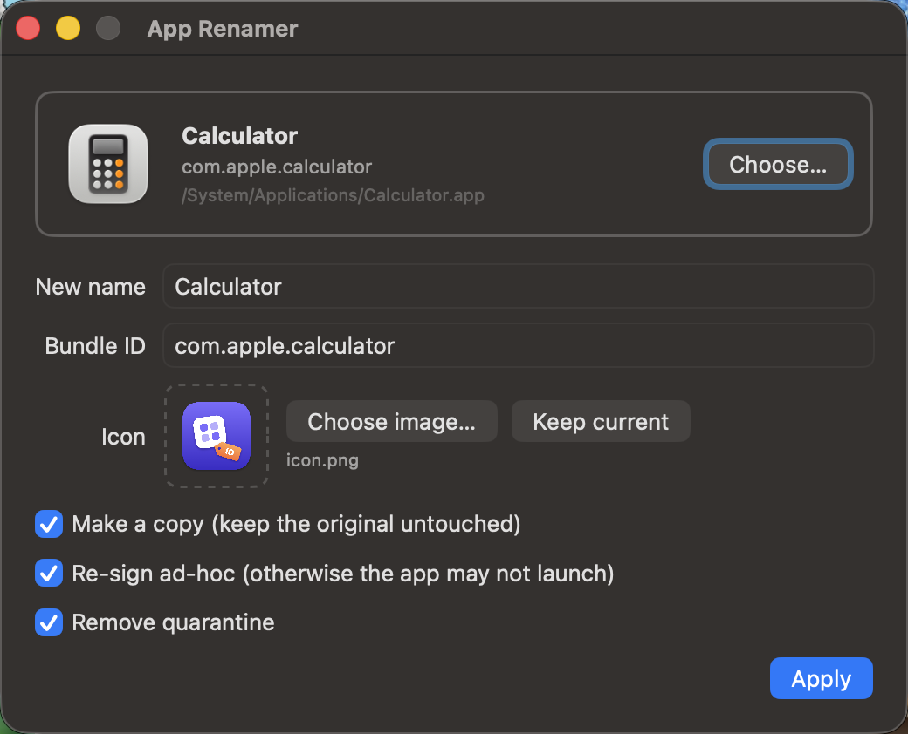

<p align="center">
  
</p>

<h1 align="center">App Renamer</h1>

<p align="center">
  A tiny macOS utility to rename any <code>.app</code> and change its bundle ID and icon.
</p>

<p align="center">
  <b>English</b> · <a href="README.ru.md">Русский</a>
</p>

<p align="center">
  
</p>

## Why

- Run **two copies** of the same app side by side: a copy with a different bundle ID gets its own settings, its own data container and its own Dock icon.
- Tell similar builds apart (staging / prod, beta / release) by name and icon.
- Rename an app so that Finder, Dock and Spotlight show the new name, not just the new file name.

## Features

- Drop an `.app` onto the window or pick one with **Choose…**.
- **Name**: updates `CFBundleName`, `CFBundleDisplayName`, the `.app` folder name and localized names in `*.lproj/InfoPlist.strings`.
- **Bundle ID**: updates `CFBundleIdentifier`.
- **Icon**: PNG, JPEG, HEIC or ICNS. The image is turned into an `.icns` with every required size, and it overrides an icon from `Assets.car` too.
- **Copy mode** (on by default): the original stays untouched, and `New Name.app` appears next to it.
- **Ad-hoc re-signing** after the changes. Without it, macOS refuses to launch the modified app.
- **Quarantine removal** (`com.apple.quarantine`).
- Refreshes the Launch Services cache, so the new name and icon show up right away.
- English and Russian UI, picked from your system language.

## Install

### Prebuilt

1. Download `AppRenamer.zip` from [Releases](../../releases/latest) and unzip it.
2. Move `AppRenamer.app` to `/Applications`.
3. The app isn't notarized, so on first launch **right-click → Open** it, or clear the quarantine flag:
   ```bash
   xattr -dr com.apple.quarantine /Applications/AppRenamer.app
   ```

### From source

You only need the Xcode Command Line Tools (`xcode-select --install`). There's no Xcode project.

```bash
git clone https://github.com/BarredEwe/app-renamer.git
cd app-renamer
./build.sh
open build/AppRenamer.app
```

`build.sh` produces a universal binary (Apple Silicon + Intel) in `build/AppRenamer.app` and an archive at `build/AppRenamer.zip`.

## Command line

Pass the app and the icon as arguments to open the window already filled in:

```bash
open -a AppRenamer --args /Applications/Some.app ~/Pictures/new-icon.png
```

## Limitations

- Re-signing **drops the original entitlements and the developer signature**. Regular apps keep working as before. Apps that rely on iCloud, Keychain groups, push notifications or check their own signature may only partly work.
- macOS won't let you modify App Store and system apps in place. Use copy mode, or grant App Renamer access under **System Settings → Privacy & Security → App Management**.
- macOS treats an app with a new bundle ID as a different app: it won't see the original's settings and data.
- Apps with auto-update (Sparkle and the like) may revert your changes when they update.
- If Finder keeps showing the old icon, restart the Dock: `killall Dock`.

## How it works

All the code is in one file, [`Sources/AppRenamer.swift`](Sources/AppRenamer.swift): SwiftUI plus the system tools `ditto`, `codesign`, `iconutil`, `xattr` and `lsregister`. Translations live in [`Resources/ru.lproj/Localizable.strings`](Resources/ru.lproj/Localizable.strings), and the source strings are the English ones. The app icon is drawn by [`tools/make-icon.swift`](tools/make-icon.swift):

```bash
swift tools/make-icon.swift Resources/icon.png
```

Requires macOS 14 Sonoma or later.

## License

[MIT](LICENSE)
