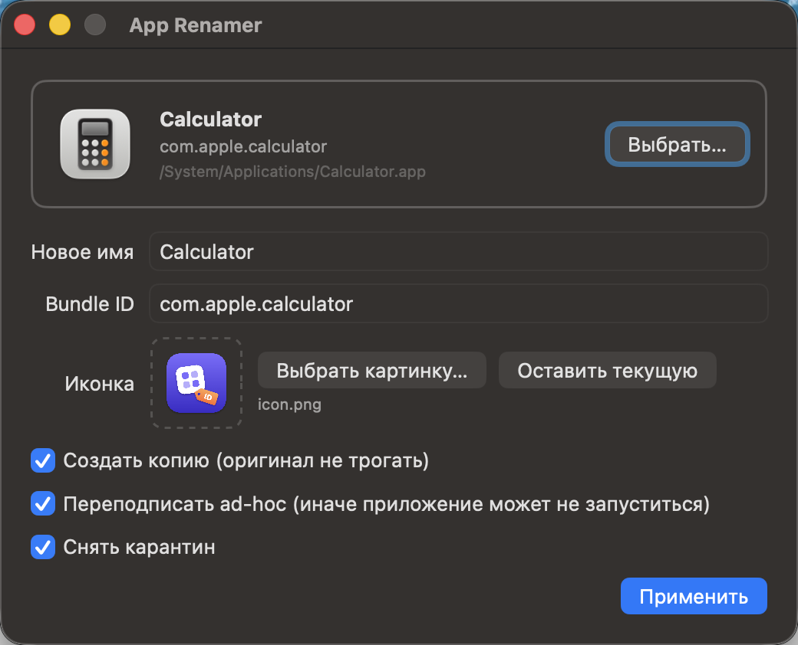

<p align="center">
  
</p>

<h1 align="center">App Renamer</h1>

<p align="center">
  Маленькое приложение для macOS: переименовать любое <code>.app</code>, сменить ему bundle ID и иконку.
</p>

<p align="center">
  <a href="README.md">English</a> · <b>Русский</b>
</p>

<p align="center">
  
</p>

## Зачем

- Запустить **две копии** одного приложения с разными настройками: у копии с другим bundle ID свои настройки, свой контейнер данных и своя иконка в Dock.
- Различать похожие сборки (stage / prod, beta / release) по имени и иконке.
- Переименовать приложение так, чтобы новое имя показывали Finder, Dock и Spotlight, а не только имя файла.

## Возможности

- Перетащите `.app` в окно или на **иконку App Renamer в Dock**, или выберите его через «Выбрать…». Картинку можно бросить туда же, вместе с приложением или отдельно, и она станет новой иконкой. Работает и **Открыть в программе → App Renamer** в Finder.
- Меняется **имя**: `CFBundleName`, `CFBundleDisplayName`, имя папки `.app` и локализованные имена в `*.lproj/InfoPlist.strings`.
- Меняется **bundle ID** (`CFBundleIdentifier`).
- Меняется **иконка**: подойдёт PNG, JPEG, HEIC или ICNS. Картинка автоматически собирается в `.icns` всех нужных размеров. Иконку из `Assets.car` новая тоже перекрывает.
- **Режим копии** (включён по умолчанию): оригинал не трогается, рядом появляется `Новое имя.app`.
- **Переподпись ad-hoc** после изменений, без неё macOS не запустит изменённое приложение.
- **Снятие карантина** (`com.apple.quarantine`).
- Обновление кеша Launch Services, чтобы новое имя и иконка появились сразу.
- Интерфейс на русском и английском, язык берётся из настроек системы.

## Установка

### Готовая сборка

1. Скачайте `AppRenamer.zip` со страницы [Releases](../../releases/latest) и распакуйте.
2. Перенесите `AppRenamer.app` в `/Applications`.
3. Приложение не нотаризовано, поэтому перед первым запуском снимите с него карантин:
   ```bash
   xattr -dr com.apple.quarantine /Applications/AppRenamer.app
   ```
   Или запустите его один раз и нажмите **«Всё равно открыть»** в **Системные настройки → Конфиденциальность и безопасность**.

### Из исходников

Нужны Xcode Command Line Tools (`xcode-select --install`). Xcode-проект не нужен.

```bash
git clone https://github.com/BarredEwe/app-renamer.git
cd app-renamer
./build.sh
open build/AppRenamer.app
```

`build.sh` собирает универсальный бинарник (Apple Silicon + Intel) в `build/AppRenamer.app` и архив `build/AppRenamer.zip`.

## Запуск из терминала

Приложение и иконку можно передать аргументами, тогда форма откроется уже заполненной:

```bash
open -a AppRenamer --args /Applications/Some.app ~/Pictures/new-icon.png
```

## Ограничения

- После переподписи **теряются исходные entitlements и подпись разработчика**. Обычные приложения работают как прежде. Те, что зависят от iCloud, Keychain-групп, push-уведомлений или проверки собственной подписи, могут работать частично.
- Приложения из App Store и системные приложения macOS не даёт менять на месте. Используйте режим копии. Для правки на месте выдайте App Renamer доступ: **Системные настройки → Конфиденциальность и безопасность → Управление приложениями**.
- Приложение с новым bundle ID система считает другим: настройки и данные оригинала оно не увидит.
- Приложения с автообновлением (Sparkle и т.п.) могут откатить изменения при обновлении.
- Если Finder упорно показывает старую иконку, перезапустите Dock: `killall Dock`.

## Как это устроено

Весь код в одном файле: [`Sources/AppRenamer.swift`](Sources/AppRenamer.swift), это SwiftUI плюс системные утилиты `ditto`, `codesign`, `iconutil`, `xattr` и `lsregister`. Строки в коде на английском, русский перевод лежит в [`Resources/ru.lproj/Localizable.strings`](Resources/ru.lproj/Localizable.strings). Иконку приложения рисует код в [`tools/make-icon.swift`](tools/make-icon.swift):

```bash
swift tools/make-icon.swift Resources/icon.png
```

Требуется macOS 14 Sonoma или новее.

## Лицензия

[MIT](LICENSE)
